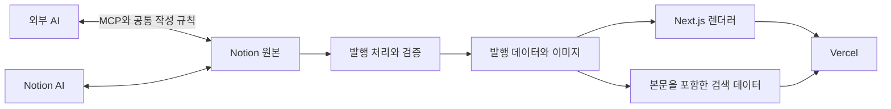

**현재 블로그 구현 스펙과 개선안**

조사일: 2026-11-14, Asia/Seoul. 개인 레포 `woongyee-blog`의 로컬 HEAD `c95bbc5` 기준.

**조사 결론**

Next.js와 Vercel을 계속 사용하면서 개선할 수 있는 구조다. 현재 구현은 Notion의 발행 글 메타데이터를 조회하고, 본문을 일반 Markdown과 HTML로 변환해 제공한다. 노션의 본문 배치 보존, 시리즈와 회차, 외부 AI와 공유할 작성 규칙, 초안과 발행본 구분은 추가 설계가 필요하다.

우선 목록 누락·본문 구조 손실·공개 상태 변경 시 캐시 처리를 수정하고, 작성 규칙과 렌더러 지원 범위를 맞추는 순서가 적절하다.

**확인 범위와 한계**

- 개인 레포와 베이스 레포의 소스, 설정, 설치된 의존성을 확인했다. 조사 시작 시 두 레포에 작업 중인 변경은 없었다.
- 개인 레포는 베이스 `765cfce` 이후 `blog.config.ts`, `app/layout.tsx` 두 파일만 달라져 있다. 베이스는 로컬 HEAD `765cfce`다.
- 환경변수는 이름과 설정 여부만 확인했다. 키·시크릿 값은 보고서에 기록하지 않았다.
- Vercel 연결에서 개인/연결 팀 범위의 `woongyee`, `blog` 이름 검색으로 해당 프로젝트를 찾지 못했다. 운영 빌드의 커밋·환경변수·웹훅 전달 상태는 미확인이다.
- 로컬에 기록된 공개 주소 `https://woongyee-blog.vercel.app`는 웹 도구에서 접근하지 못했고, 터미널 요청도 DNS 조회에 실패했다. 이 환경의 접근 실패로 운영 서비스 장애를 단정할 수 없다.
- 실제 Notion 데이터를 변경하거나 Cloudinary에 업로드하지 않았다. 프로덕션 빌드와 배포도 수행하지 않았다.

**현재 기술 스택**

| 영역 | 확인한 구현 |
|---|---|
| 웹 프레임워크 | Next.js 15.5.4, App Router, React 19.1.0 |
| 언어·스타일 | TypeScript, Tailwind CSS 4; 설치된 TypeScript 5.9.3, Tailwind 4.1.14 |
| 개발·빌드 | `next dev --turbopack`, `next build --turbopack` |
| CMS | `@notionhq/client` 5.1.0; Notion data source 조회 |
| 본문 변환 | `notion-to-md` 3.1.9 → remark/GFM → rehype → HTML |
| 이미지 | Cloudinary 2.7.0; 커버·본문 이미지 복사와 크기/품질 변환 |
| 댓글 | Giscus 스크립트; 기능 토글과 저장소 설정이 있을 때 표시 |
| 방문 분석 | Vercel Analytics; 기능 토글에 따라 로드 |
| 공유 이미지 | `/api/og`, `@vercel/og`, Edge runtime |
| 데이터 저장 | 애플리케이션 자체 DB·검색 엔진·발행본 저장소 구현 없음 |
| CI | 레포에 `.github/workflows` 없음. Vercel의 실제 Git 연동 설정은 미확인 |

근거: [package.json](/Users/woongyee/dev/notion_blog/woongyee-blog/package.json:5), [루트 레이아웃](/Users/woongyee/dev/notion_blog/woongyee-blog/app/layout.tsx:48).

**화면과 콘텐츠 구조**

| 경로 | 동작 |
|---|---|
| `/` | 최신 글 9개, 글 수 기준 카테고리·태그 목록 |
| `/blog` | 조회된 발행 글 전체를 카드로 표시; 페이지 이동 UI 없음 |
| `/blog/[slug]` | 본문, 발행일, 읽기 시간, 태그, 댓글, 목차·참고 자료 사이드바 |
| `/categories`, `/categories/[category]` | 발행 글 메타데이터를 기준으로 분류 |
| `/tags`, `/tags/[tag]` | 발행 글 메타데이터를 기준으로 분류 |
| `/search?q=...` | 서버에서 메타데이터 검색 후 카드 목록 표시 |
| `/about` | 코드에 작성된 소개 화면; Notion 본문과 연결되지 않음 |
| `/test` | Notion 연결 진단 화면; robots 제외 규칙이 있지만 운영 전용 접근 제한은 없음 |
| `/sitemap.xml`, `/robots.txt` | 코드에서 생성 |
| `/api/webhook/notion` | Notion 변경을 받아 캐시 무효화와 이미지 처리 |
| `/api/og` | 제목·설명으로 공유 이미지 생성 |

Notion 속성은 `Title`, `Slug`, `Status`, `PublishDate`, `Tags`, `Category`, `Excerpt`, `Featured` 등을 전제한다. `Status` 조회는 Select 타입의 `Published`를 사용한다. Notion의 네이티브 Status 타입으로 바꾸려면 조회·파싱 로직도 수정해야 한다.

필수값 검사는 제목과 slug 중심이며, slug 중복·시리즈 회차·지원 블록·발행일에 대한 통합 검증은 없다. 발행일이 없으면 파싱 시각을 사용한다. 설정에 있는 `CoverImage` 속성 매핑은 실제 커버 파서에서 사용하지 않고 `page.cover`를 읽는다.

근거: [속성 파서](/Users/woongyee/dev/notion_blog/woongyee-blog/lib/notion/parser.ts:89), [목록 화면](/Users/woongyee/dev/notion_blog/woongyee-blog/app/blog/page.tsx:15).

**검색은 현재 어떻게 동작하는가**

1. 헤더 입력창에서 검색어 앞뒤 공백을 제거하고 `/search?q=...`로 이동한다.
2. 서버 페이지가 `searchPosts(query)`를 호출한다. 별도의 `/api/search`는 없다.
3. `getPublishedPosts()`가 캐시된 발행 글 메타데이터를 반환한다. 캐시가 없거나 갱신이 필요할 때 Notion을 조회한다.
4. 제목·요약·태그를 소문자로 바꿔 검색어 전체가 포함되는지 `includes()`로 검사한다.
5. 결과는 기존 발행일 내림차순을 유지하며, 결과 수와 카드를 표시한다.

본문·카테고리·시리즈 이름은 검색하지 않는다. 검색어 토큰화, 관련도 순위, 오타 보정, 본문 발췌, 결과 페이지네이션도 없다. URL에 직접 넣은 검색어는 검색 함수에서 trim/정규화하지 않는다. Notion MCP 검색이나 Notion AI 검색과도 별개다.

현재 검색을 실행할 때마다 모든 본문을 Notion에서 읽는 것은 아니다. 기본 입력은 메타데이터 캐시다. 다만 메타데이터 파싱 중 커버 이미지 업로드가 호출되어 조회와 이미지 처리 책임이 섞여 있다.

근거: [검색창](/Users/woongyee/dev/notion_blog/woongyee-blog/components/common/SearchBar.tsx:14), [검색 페이지](/Users/woongyee/dev/notion_blog/woongyee-blog/app/search/page.tsx:25), [검색 함수](/Users/woongyee/dev/notion_blog/woongyee-blog/lib/notion/api.ts:248).

**본문·이미지·갱신 흐름**

본문은 slug와 Published 조건으로 페이지를 찾은 뒤 이미지 추출, Cloudinary 업로드 호출, Notion→Markdown 변환, HTML 변환을 거친다. HTML 변환 과정에서 목차와 참고 자료를 추출한다.

이미지는 블록을 재귀적으로 읽어 추출한다. 업로드 시 고정 public ID와 `overwrite: false`를 사용하지만, 호출 전에 기존 처리 결과를 조회하는 별도 인덱스는 없다. 본문 조회와 웹훅 양쪽에서 같은 이미지 처리 경로가 실행될 수 있다. 메타데이터 생성과 본문 렌더링도 각각 `getPostBySlug()`를 호출하며 명시적인 요청 내 메모이제이션이 없다.

발행 목록에는 `unstable_cache`, `posts` 태그, 3,600초의 재검증 설정이 적용되어 있다. 글 상세는 `generateStaticParams()`로 알려진 slug를 생성하고 웹훅에서 경로를 무효화한다. 설정의 `revalidate.posts`와 `REVALIDATE_TIME.post`는 상세 페이지에 연결되어 있지 않다. 따라서 목록의 1시간 갱신을 본문 전체의 1시간 갱신으로 해석하면 안 된다. Next.js의 시간 기반 재검증은 시간이 지난 뒤 요청을 계기로 동작한다. [Next.js 15 ISR 문서](https://nextjs.org/docs/15/app/guides/incremental-static-regeneration)

Cloudinary 처리 실패 시 원래 Notion URL을 사용한다. Notion 업로드 파일의 URL에는 만료 시간이 있으므로 이 fallback은 영구 이미지 주소를 보장하지 않는다. [Notion 파일 문서](https://developers.notion.com/reference/file-object)

근거: [본문 조회](/Users/woongyee/dev/notion_blog/woongyee-blog/lib/notion/api.ts:99), [상세 페이지](/Users/woongyee/dev/notion_blog/woongyee-blog/app/blog/[slug]/page.tsx:19), [이미지 조회](/Users/woongyee/dev/notion_blog/woongyee-blog/lib/notion/images.ts:79), [업로드](/Users/woongyee/dev/notion_blog/woongyee-blog/lib/cloudinary/upload.ts:71).

**실제 소스로 재현한 문제**

아래 재현은 실제 소스를 메모리에서 TypeScript 변환 후 호출했다. 외부 API·캐시·이미지 업로드는 모의 구현을 사용했다. 실제 배포 서버에 이벤트를 보내거나 Notion 데이터를 편집하지 않았다.

| 문제 | 확인한 결과 | 영향 |
|---|---|---|
| 발행 글 목록 100개 제한 | 101개 응답을 페이지로 나누는 모의 API에서 첫 100개만 반환. 다음 페이지 호출 0회. 101번째 글 검색 결과 0개 | 검색·전체 목록·태그/분류 집계·사이트맵에서 오래된 글 누락 |
| 노션 단 구성 손실 | 2개의 column을 `notion-to-md`로 변환 후 실제 HTML 파이프라인에 입력하자 연속된 두 문단으로 출력 | 노션 배치가 블로그에 보존되지 않음 |
| 토글 동작 손실 | 변환기가 생성한 `<details>/<summary>`를 실제 HTML 파이프라인이 제거. 자식 내용은 일반 문단으로 남음 | 접어둔 내용이 펼쳐져 표시되고 토글 제목이 빠질 수 있음 |
| 참고 절의 본문 제거 | `참고 자료` 제목과 설명+링크 문단을 입력하자 둘 다 제거되고 링크만 수집 | 작성한 설명이 사라지고 배치가 바뀜 |
| Published → Draft 무효화 누락 | Draft 상태 반환 시 HTTP 200, skipped 1, 캐시 무효화 0회 | 기존에 공개된 목록·상세의 즉각적인 비공개 반영을 보장하지 못함 |
| 삭제 시 상세 경로 처리 누락 | 삭제 이벤트에서 `tag:posts`, `/sitemap.xml`만 무효화 | 기존 글 상세의 캐시가 남을 수 있음 |
| 내부 실패를 성공 HTTP로 응답 | 페이지 조회 실패 시 failed 1이면서 HTTP 200, 최상위 success true | 전달 성공과 실제 처리 성공이 구분되지 않음 |

본문 변환 재현 결과:

```html
<p>Left column</p>
<p>Right column</p>
<p>Nested content</p>
```

원본 테스트에는 2단과 토글 제목 `More`가 있었으나, 최종 HTML에는 단 구조와 토글 요소·제목이 없었다.

근거: [목록 조회](/Users/woongyee/dev/notion_blog/woongyee-blog/lib/notion/api.ts:28), [HTML 변환](/Users/woongyee/dev/notion_blog/woongyee-blog/lib/utils/markdown.ts:63), [참고 절 제거](/Users/woongyee/dev/notion_blog/woongyee-blog/lib/utils/extractReferences.ts:83), [Draft 건너뛰기](/Users/woongyee/dev/notion_blog/woongyee-blog/app/api/webhook/notion/route.ts:180), [삭제 처리](/Users/woongyee/dev/notion_blog/woongyee-blog/app/api/webhook/notion/route.ts:137), [웹훅 응답](/Users/woongyee/dev/notion_blog/woongyee-blog/app/api/webhook/notion/route.ts:231).

**추가로 확인한 구현 공백**

- 이미지 블록 조회도 각 부모의 첫 100개 자식만 읽고 `has_more`/`next_cursor`를 처리하지 않는다. 긴 글의 뒤쪽 이미지는 영구 URL 치환에서 빠질 수 있다. 본문 변환 라이브러리의 페이지네이션과는 별개 문제다.
- slug를 바꾸면 웹훅은 새 slug만 알고 이전 경로를 명시적으로 무효화하지 않는다. 페이지 ID와 이전 발행 slug의 연결 기록이 필요하다.
- 웹훅은 중복 이벤트·전달 순서를 기록하지 않고 요청 처리 중 이미지 작업을 기다린다. Notion은 이벤트 순서를 보장하지 않으며, 수신 확인 실패 시 재시도한다. 처리 실패를 200으로 응답할 경우 자체 재시도 기록이 필요하다. [전달 동작](https://developers.notion.com/reference/webhooks-events-delivery)
- 웹훅 초기 확인 처리는 `url_verification/challenge` 형식을 전제한다. 현재 공식 문서는 `verification_token` 수신 후 수동 확인 절차를 설명한다. 신규 연결·재연결 절차와 안내 문서를 이에 맞춰 정리해야 한다. 서명 검증의 JSON 재직렬화 방식 자체는 현재 공식 Node 예시와 같은 방식이다. [웹훅 설정 문서](https://developers.notion.com/reference/webhooks)
- 본문 조회의 예외는 `null`로 바뀌어 실제로 없는 글과 Notion 장애를 구분하지 못하고 404로 이어질 수 있다.
- 시리즈 타입·관계·회차·화면·이전/다음 글 기능이 없다. 목록 순서는 발행일 내림차순이며 수동 순서 속성은 없다.
- 초안 미리보기, 명시적인 재발행, 발행본 버전·작성 규칙 버전, 발행 전 검증이 없다.
- MCP 연결이나 AI Skill은 이 웹 레포에 구현되어 있지 않다. AI 도구와 Notion 사이의 편집 설정으로 별도 구성할 수 있으며, 독자용 사이트에 AI 실행 기능을 넣어야 하는 것은 아니다.
- 페이지네이션 함수와 10개씩 설정은 있지만 `/blog` 화면에서 사용하지 않는다.
- `features.search`, `darkMode`, `tableOfContents`, `readingTime`은 해당 UI의 활성 여부에 연결되지 않는다. 검색창·목차·읽기 시간은 별도 조건 없이 사용하고, 다크 모드는 OS 색상 설정에 따른 CSS다. `pwa` 설정에 대응하는 manifest/service worker 구현은 없다.
- `analytics.gaId`, `theme.primaryColor` 등 일부 설정은 실제 소비 코드가 없다. Giscus와 Vercel Analytics 토글은 사용된다.
- README·설정 가이드·재검증 문서는 `/api/revalidate`를 안내하지만 해당 라우트는 없다. 유틸리티도 이 없는 경로를 호출한다. 실제 라우트는 `/api/webhook/notion`이다.
- 로컬 환경에는 `NEXT_PUBLIC_SITE_URL`이 있고 소스가 요구하는 `NEXT_PUBLIC_BLOG_URL`은 없다. 실제 환경 로더로도 확인했다. 루트 레이아웃의 `new URL(blogConfig.blog.url)`에 유효한 값이 전달되지 않는다. 운영 환경도 같은 상태인지는 미확인이다.

**개선 우선순위**

| 단계 | 작업 | 완료 기준 |
|---|---|---|
| 1. 기존 동작 수정 | 글 목록·이미지 블록 페이지네이션, 공개 해제·삭제·slug 변경 캐시 무효화, 웹훅 실패 처리, URL 환경변수 정리 | 101번째 글과 긴 글 이미지 누락 없음. 공개 해제 후 검색·목록·직접 URL에서 같은 공개 상태 확인. 실패를 재처리할 수 있음 |
| 2. 작성·렌더링 기준 확정 | 노션 작성 Skill과 지원 블록 규칙을 정의하고, 단·토글·콜아웃·이미지 캡션을 보존하는 렌더러 구현 | 대표 노션 문서와 PC/모바일 미리보기를 비교. 참고 절을 포함한 본문 임의 삭제 없음 |
| 3. 시리즈·발행 관리 | 게시글–시리즈 관계, 시리즈 내 순번·목록 순서, 미리보기, 발행본과 편집본 구분 | 외부 AI 초안→직접 편집→시리즈 재정렬→발행까지 한 번에 검증 |
| 4. 검색 확장 | 발행 데이터에서 본문 텍스트·시리즈 정보를 추출해 경량 검색 데이터 구성 | 본문에만 있는 검색어도 검색. 제목 우선 순위와 결과 발췌 제공. 비공개 글 제외 |
| 5. 관리 부담 축소 | 개인 레포로 작업 집중, 미사용 설정·문서 정리, lint·typecheck와 핵심 회귀 검증 자동화, 의존성 업데이트 검토 | 설정과 실제 동작의 차이 해소. 같은 콘텐츠와 설정으로 결과 재현 |

검색 엔진을 먼저 추가하기보다, 모든 발행 글을 빠짐없이 읽고 본문에서 검색용 텍스트를 만드는 구조를 먼저 정하는 것이 좋다. 글의 수·검색 응답 크기·처리 시간을 확인한 뒤 검색 데이터를 브라우저에서 사용할지 서버 캐시에 둘지 결정할 수 있다. 실제 글 수와 트래픽은 이번 조사에서 확인하지 않았다.

**추천하는 다음 구조**



발행 데이터에는 글 메타데이터, 블록 트리, 시리즈와 순서, 본문 텍스트, 이미지 매핑, 원본 수정 시각과 적용한 작성 규칙 버전을 함께 담는 방식을 권장한다. 원본 조회와 이미지 저장을 화면 렌더링에서 분리하면 검색·미리보기·본문이 같은 발행본을 사용할 수 있다. 명시적인 발행본 보존을 도입할 때는 Next.js 캐시와 구분되는 저장 위치와 이전 발행본 복구 방법도 함께 정해야 한다.

노션의 공식 Markdown API도 선택지이지만 Notion 전용 태그를 표현하는 파서가 필요하다. 현재의 일반 GFM 파이프라인에 연결하는 것만으로 배치 보존이 해결되지는 않는다. 본문 배치 요구에는 공식 블록 구조를 기반으로 하는 렌더러를 우선 검토한다. API가 노출하는 단·스타일 정보와 미지원 블록의 경계는 대표 문서로 확인한다. [Notion 블록 문서](https://developers.notion.com/reference/block), [공식 Markdown API](https://developers.notion.com/guides/data-apis/working-with-markdown-content)

처음부터 별도 관리 화면이나 자체 AI 실행 서버를 추가할 필요는 없다. 노션을 작성·이력·AI 연결의 중심으로 두고, 개인 Next.js 레포가 발행·표시·검색을 담당하도록 범위를 잡을 수 있다.

**수행한 검증**

| 검사 | 결과 |
|---|---|
| `npm run lint` | 통과, exit 0 |
| `./node_modules/.bin/tsc --noEmit --incremental false` | 통과, exit 0 |
| `npm ls --depth=0` | 설치된 버전 확인. 일부 extraneous 패키지는 있으나 exit 0 |
| 모의 Notion 응답으로 실제 조회·검색 함수 실행 | 101번째 글 누락 재현 |
| 모의 요청으로 실제 웹훅 핸들러 실행 | Draft 무효화 누락, 삭제 시 목록/사이트맵만 무효화, 내부 실패 HTTP 200 재현 |
| 실제 참고 절 플러그인 실행 | 설명 문단 제거 재현 |
| 실제 `notion-to-md` 출력과 실제 HTML 변환 함수 연결 | column과 toggle 구조 손실 재현 |
| Next 환경변수 로더 실행 | `NEXT_PUBLIC_BLOG_URL` 누락 확인; 값은 출력하지 않음 |
| 운영 사이트 브라우저·실제 API 왕복 검증 | 미수행. 연결 대상과 네트워크 접근을 확인하지 못함 |
| 프로덕션 빌드 | 미수행. 현재 로컬 URL 설정이 불일치하며, 빌드 중 조회 경로에서 실제 Cloudinary 업로드가 실행될 수 있어 소스·격리 검증으로 조사 |

이번 변경은 이 보고서 추가뿐이다. 애플리케이션 코드·환경변수·Notion 콘텐츠·Vercel 설정은 수정하지 않았다.
